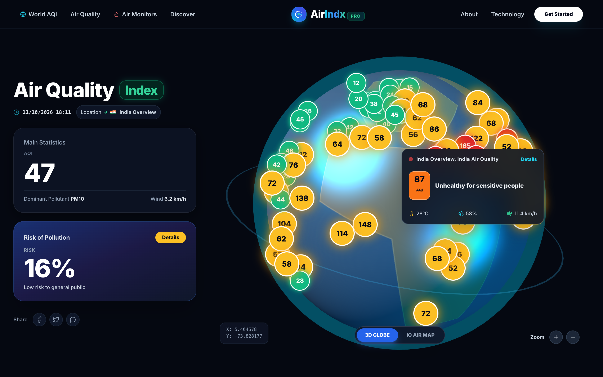
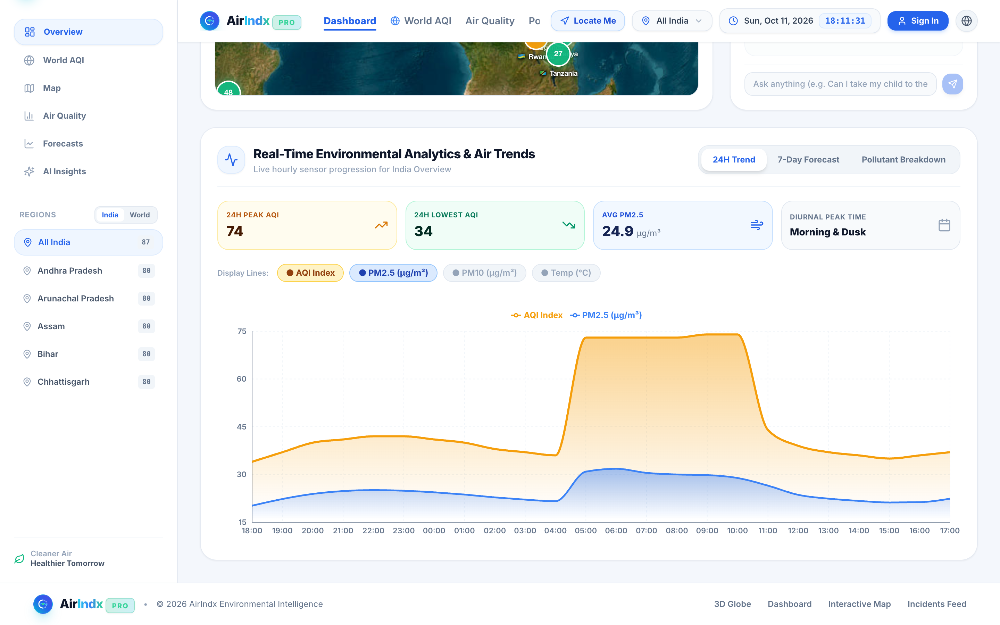
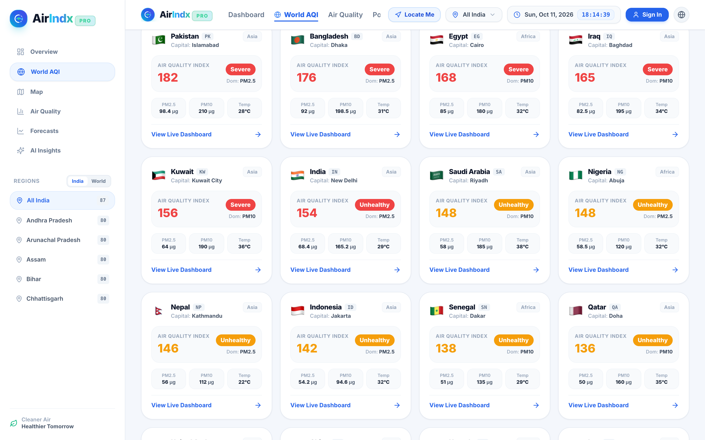
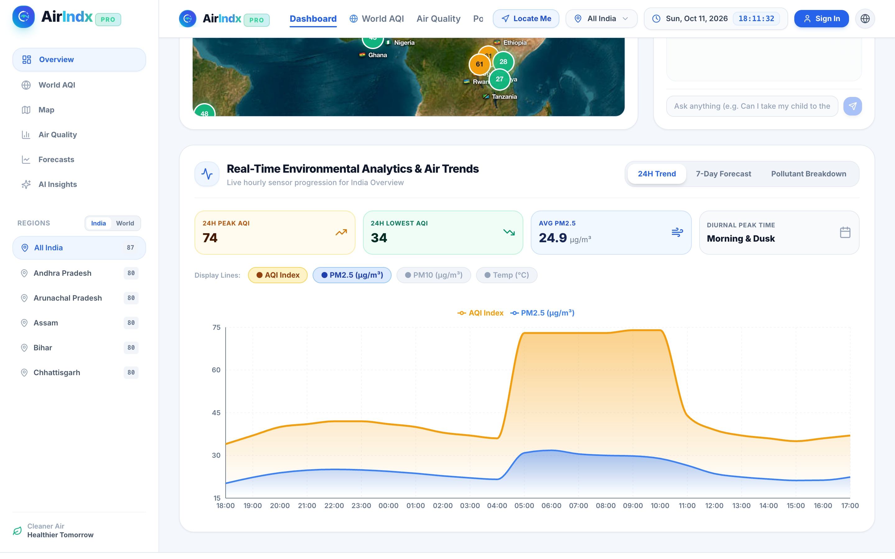
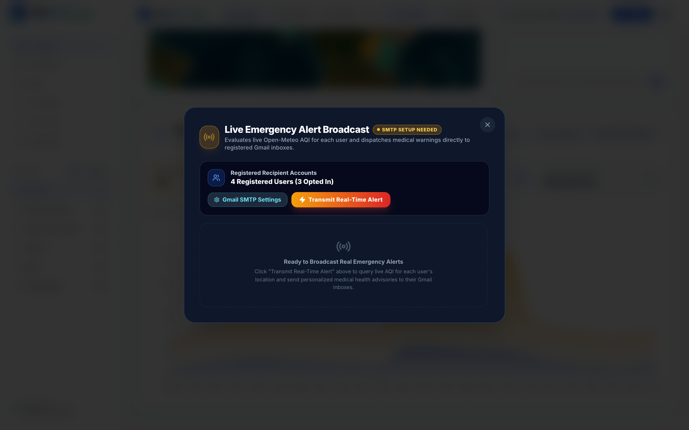

# 🌍 AirIndx Pro — Environmental Intelligence & Real-Time Alert Platform

[](https://vercel.com/)
[](https://reactjs.org/)
[](https://www.typescriptlang.org/)
[](https://vitejs.dev/)
[](https://fastapi.tiangolo.com/)
[](https://nodemailer.com/)
[](https://opensource.org/licenses/MIT)

**AirIndx Pro** is an enterprise-grade atmospheric monitoring and personal environmental health intelligence platform. It fuses real-time CPCB ground station feeds, Open-Meteo satellite atmospheric data, 3D WebGL globe visualizations, and clinical risk algorithms to deliver personalized air quality advisories and automated warning alerts directly to users via Gmail.

---

## 📸 Visual Showcase & Screenshots

### 1. 🌐 3D Interactive WebGL Earth Globe (Landing Page)
> Explore atmospheric air quality markers, real-time pollution risk scores, and global weather patterns rendered on an interactive 3D WebGL Earth globe.



---

### 2. 📊 Live Command Center Dashboard
> Real-time AQI index tracking, PM2.5 / PM10 particulate levels, meteorological sensors, satellite monitoring maps, and conversational AI Assistant.



---

### 3. 🗺️ Worldwide Country AQI Rankings & Analytics
> Live environmental metrics across 50+ countries including Pakistan, India, Bangladesh, Egypt, Kuwait, Saudi Arabia, and Nigeria with pollutant breakdown.



---

### 4. 📈 24H Diurnal Particulate Trends & Atmospheric Forecasting
> Hour-by-hour air quality trends, diurnal peak inhalation windows, and multi-day meteorological forecasting models.



---

### 5. 🔐 Streamlined Gmail Registration & Authentication
> Hassle-free account setup requiring only **Full Name**, **Gmail Address**, and **Password**. Directly receives authentic verification passcodes in your inbox.


---

### 6. 🚨 Real-Time Emergency Health Warning Dispatcher
> Emergency broadcast engine that continuously evaluates live AQI against registered users' medical profiles (Asthma, Heart Disease, Allergies) and delivers alerts via Nodemailer.



---

## ✨ Key Features

- **🌐 3D WebGL Earth Atmosphere**: Smooth 60fps globe rendering featuring live interactive city markers, rotation controls, and regional heatmaps.
- **🛰️ Multi-Source Satellite & Station Telemetry**: Combines CPCB ground station telemetry and Open-Meteo atmospheric models.
- **🤖 Built-in AI Health Assistant**: Layman-friendly environmental recommendations, mask advisories, and outdoor activity assessments powered by Google Gemini.
- **📧 Authentic Gmail Alerts via Nodemailer**:
  - Verification codes delivered to user Gmail inboxes.
  - Periodic background health monitoring daemon dispatching personalized warnings whenever local AQI crosses chosen safety thresholds.
- **🏥 Personalized Clinical Profiles**: Customized precautions tailored for asthma patients, cardiovascular conditions, elderly individuals, athletes, and children.
- **🏫 School Safety & Inhalation Dose Engine**: Guidance for school sports clearance, HEPA indoor purifier operation, and stubble fire transport tracking.

---

## 🛠️ Technology Stack

| Layer | Technologies |
|---|---|
| **Frontend** | React 18, TypeScript, Vite 6, Tailwind CSS, Lucide Icons, Recharts, Leaflet, Three.js |
| **Backend** | Python 3, FastAPI, Uvicorn, SQLite (WAL mode), Nodemailer (Node.js engine), Pydantic |
| **Data APIs** | Open-Meteo Air Quality & Weather API, Google Gemini AI API |
| **Deployment** | Vercel (Frontend Client), Docker / Cloud VPS (Backend Engine) |

---

## 🚀 Getting Started

### Prerequisites
- **Node.js**: v18.0.0 or higher
- **Python**: v3.9 or higher

### 1. Clone the Repository
```bash
git clone https://github.com/shreshth0007/AirIndx.git
cd AirIndx
```

### 2. Frontend Setup
```bash
# Install frontend dependencies
npm install

# Start Vite development server
npm run dev
```
Open [http://localhost:3000](http://localhost:3000) in your browser.

### 3. Backend Setup
```bash
# Navigate to backend directory
cd backend

# Install Python dependencies
pip install -r requirements.txt

# Start FastAPI server
python3 -m uvicorn app:app --host 0.0.0.0 --port 8000
```
API Documentation will be available at [http://localhost:8000/docs](http://localhost:8000/docs).

---

## ☁️ Deploying on Vercel

The frontend is fully configured for deployment on [Vercel](https://vercel.com):

1. Push your changes to GitHub (`git push origin main`).
2. Go to **[vercel.com](https://vercel.com/)** and click **"Add New..."** > **"Project"**.
3. Import your **`AirIndx`** repository.
4. Framework preset **`Vite`** is automatically detected.
5. In **Environment Variables**, add:
   - `VITE_BACKEND_API_URL`: Your backend API URL (e.g. `https://your-api-domain.com`)
   - `VITE_GEMINI_API_KEY`: Your Gemini API key
6. Click **Deploy**.

---

## 📄 License

This project is licensed under the MIT License — see the [LICENSE](LICENSE) file for details.

© 2026 AirIndx Environmental Intelligence Platform. All rights reserved.